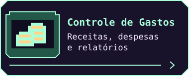
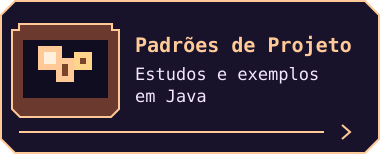

**Higor Santos · Backend com Java e Spring Boot**

Curto jogos e estudo backend. Meus projetos passam por APIs REST, dados e padrões de projeto. No Assistente Financeiro, explorei como transformar um comando de texto ou voz em uma consulta ou registro de transação.

## Selecione um cartucho

  
  

## Equipamento do jogador

## Contato

